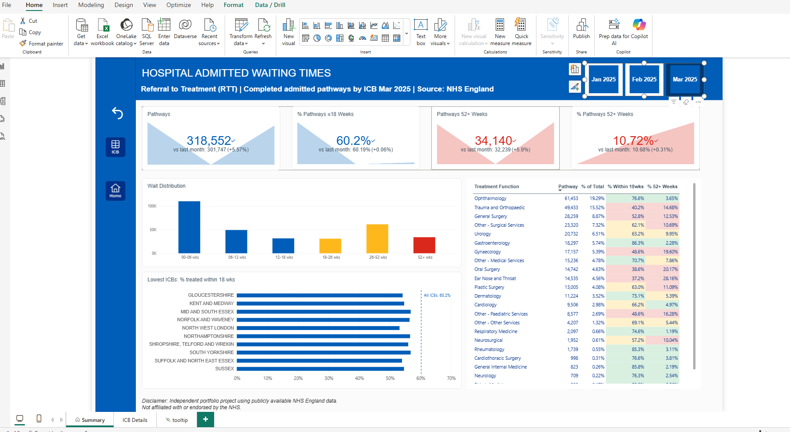
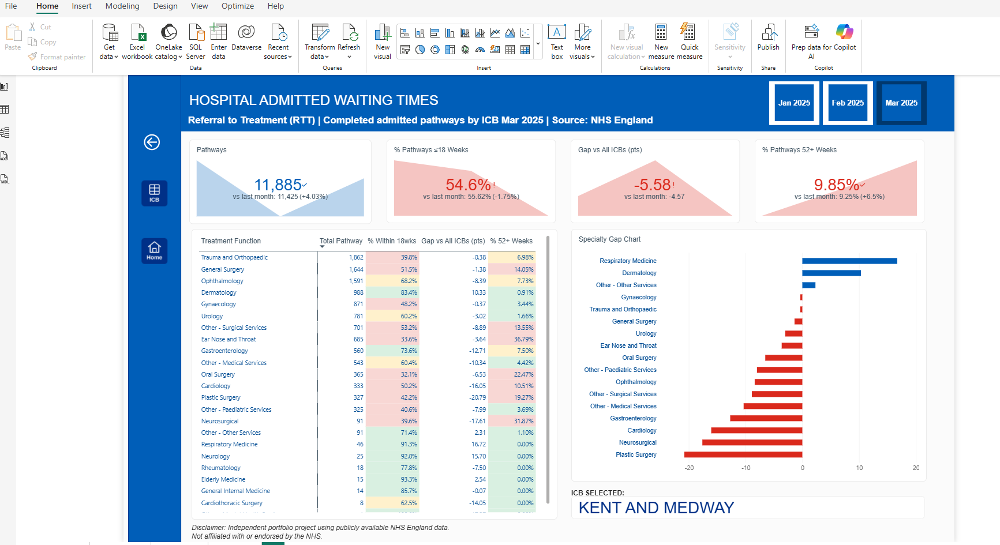
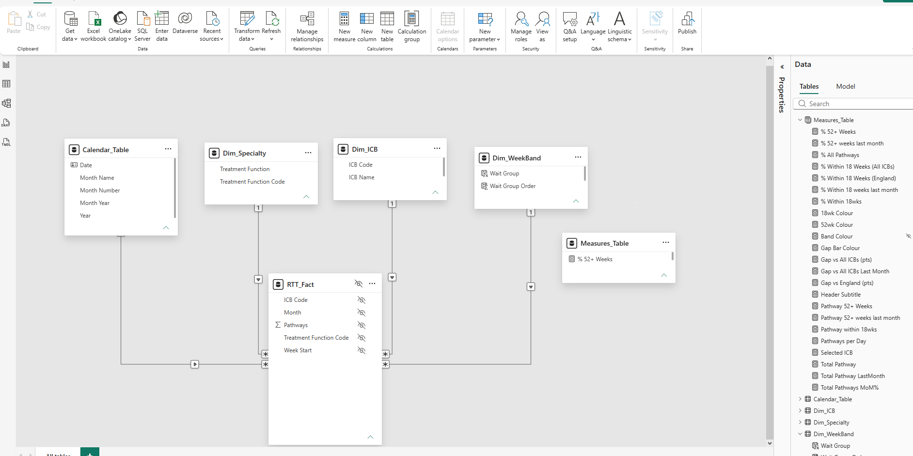

# Hospital Admitted Waiting Times: Power BI Dashboard

An end-to-end Power BI project that turns raw NHS England waiting-time spreadsheets into an interactive, two-page dashboard. It shows how long patients waited for admitted hospital treatment across England's 42 Integrated Care Boards (ICBs) for **January, February and March 2025**.




## The question

**Which ICBs and specialties have the longest waits for admitted hospital treatment, and did performance change between January and March 2025?**

## The data

- **Source:** [NHS England, Consultant-led Referral to Treatment Waiting Times Data 2024-25](https://www.england.nhs.uk/statistics/statistical-work-areas/rtt-waiting-times/rtt-data-2024-25/): the *Admitted Commissioner* monthly Excel files for January, February and March 2025 (ICB sheet). Published by NHS England and reused here with attribution; see the source page for the publisher's reuse terms.
- **What a row means:** the number of patients treated for one ICB, one specialty ("treatment function") and one week-waited band. The bands are one-week slices, from `>0-1` (more than 0 and up to 1 week) through `>103-104`, plus a final `104 plus` band for waits over two years. That gives 105 bands in total.
- **Important:** these are *completed* pathways, meaning patients who have already been treated. This is not the size of the current waiting list, so figures are not comparable with NHS England's headline 18-week performance.
- **Raw shape:** each file has 13 title rows above the table and 118 columns, with one column per week band.

## What I did, step by step

**1. Profiled the data.** I checked every sheet, found the real header row, and found two traps: a "Total" row per ICB (`C_999`) that would double-count patients, and an "NHS ENGLAND" entry that is not a real ICB. I reconciled against the published national total each month: the 42 ICBs plus NHS ENGLAND equal the national figure (March: 318,607 + 9,045 = 327,652; January: 320,101 + 9,510 = 329,611).

**2. Cleaned and reshaped in Power Query.**
- Combined the monthly files from a folder using a sample-file transform. Adding a new month means dropping the file in the folder and refreshing, which is how January was added.
- Removed the 13 title rows, promoted headers, and **unpivoted the 105 week-band columns** from wide to long format.
- Dropped pre-calculated summary columns, filtered out the Total rows, and excluded the unallocated "NHS ENGLAND" rows.
- Extracted the reporting month from each file name, built a numeric `Week Start` (0 to 104) so bands sort and calculate correctly, and shortened ICB and specialty names for readable charts.

**3. Built a star-schema data model** (about 304,000 rows: 42 ICBs × 23 specialties × 105 bands × 3 months).

| Table | Role |
|---|---|
| RTT_Fact | Patient counts by ICB, specialty, week band and month |
| Dim_ICB (42), Dim_Specialty (23), Dim_WeekBand (105) | Dimensions |
| Calendar_Table | Date table for time intelligence |
| Measures_Table | All DAX measures in one place |



**4. Wrote the DAX measures.** The core ones:

```DAX
Total Pathways = SUM ( RTT_Fact[Pathways] )

% Within 18wks = DIVIDE(
    [Pathway within 18wks], [Total Pathway]
)

% 52+ Weeks = DIVIDE(
    [Pathway 52+ Weeks], [Total Pathway]
)

Total Pathway LastMonth = CALCULATE(
    [Total Pathway], DATEADD(Calendar_Table[Date], -1, MONTH)
)

Gap vs All ICBs (pts) = 
VAR v = [% Within 18wks]
RETURN
    IF ( ISBLANK ( v ), BLANK (), ( v - [% Within 18 Weeks (All ICBs)] ) * 100 )
```

Other measures cover month-on-month change, share of total, ICB rank, colour-coding and dynamic titles and subtitles. The gap measure returns blank for specialties with no patients, so empty rows are not shown as false underperformance.

**5. Designed the report.** NHS-inspired blue palette, Arial throughout, KPI cards, a wait-length chart, a specialty table with colour bands, and a "lowest 10 ICBs" chart with an all-ICB benchmark line. Colours are sign-adjusted so blue is always good: a higher % within 18 weeks is good, but a higher % of long waits is bad.

**6. Added interactivity.** A synced month slicer, **drill-through** from an ICB to a detail page comparing it with all ICBs specialty by specialty, a hover tooltip page showing an ICB's wait distribution, navigation buttons, and a reset bookmark. The detail page hides specialties with fewer than 30 patients from the gap chart.

## Key findings

| Month | Pathways | Per day | Within 18 weeks | Waited 52+ weeks |
|---|---|---|---|---|
| January | 320,013 | about 10,300 | 61.1% | 10.6% |
| February | 301,747 | about 10,800 | 60.2% | 10.7% |
| March | 318,552 | about 10,300 | 60.2% | 10.7% |

- **Volume.** February looks lower, but it has 28 days against 31. Per day, it was actually the busiest month.
- **Speed.** The share treated within 18 weeks slipped by about 0.9 points from January to February and then held steady.
- **Long waits.** Just over 10% of treated patients had waited a year or more in every month (about 32,000 to 34,000 patients each month), with no clear improvement.
- **Specialties stay in the same order.** Gastroenterology is consistently best (about 86% within 18 weeks), and Ophthalmology is steady at about 77%. Trauma and Orthopaedics (about 40%) and Ear, Nose and Throat (about 38%, with 27 to 28% waiting 52+ weeks) are consistently weakest. Gynaecology slipped from 50.1% to 48.6%.
- **ICBs.** Seven of the ten lowest-performing ICBs are the same in January and March, including North West London and Suffolk and North East Essex, with roughly 51 to 57% treated within 18 weeks.

## Design decisions and limitations

- **Three months only.** Month-on-month changes are shown, but three points are too few to call a trend.
- **Commissioner basis.** Data is by the ICB that pays for care, not the hospital trust that delivers it.
- **Excluded rows.** "NHS ENGLAND" rows (pathways not assigned to an ICB) are excluded from ICB comparisons, so totals are a little below NHS England's national figure.
- **Colour bands** (green, amber, red) are my own illustrative thresholds, not official NHS targets.
- **Small counts.** Percentages for specialties with few patients in one ICB swing widely and should be read alongside volume.

## Skills demonstrated

Power Query (folder combine, unpivot, custom columns), data cleaning and reconciliation, star-schema modelling, DAX (time intelligence, ALL, SWITCH, dynamic titles), report design and accessibility, drill-through, bookmarks, tooltip pages, and written documentation of assumptions.

## Repository

```
├── ICB_Commissioner.pbix
├── Image/          # screenshots used in this README
└── README.md
```
KPI cards ignore the month selector. The four KPI cards on each page always show the latest month in the data compared with the previous month, so the headline figures stay fixed and the cards can show the three-month trend. The charts and tables follow the month selector, so the cards will differ from them when January or February is selected.

*Independent portfolio project using publicly available NHS England data. Not affiliated with or endorsed by the NHS.*
